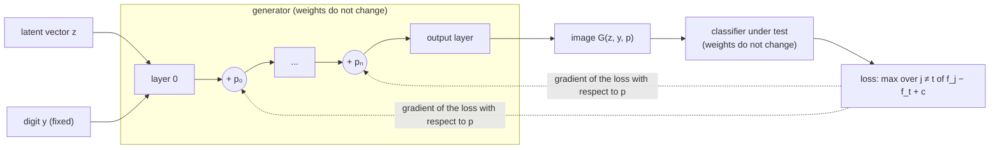

# Setup

Build the docker container:

```bash
docker build --build-arg USERNAME=$USER --build-arg USER_UID=$(id -u) --build-arg USER_GID=$(id -g) -t torch_matplotlib:2.8.0 .
```

Then start the `devcontainer`:

- Download [VSCode](https://code.visualstudio.com/Download) for your platform;
- Install the Dev Containers extension;
- In VSCode, open the Command Palette (`Ctrl+Shift+P`, or `Cmd+Shift+P` on macOS) and run the command "Dev Containers: Open Folder in Container...";
- Select the `gan-test-generation` folder.

You can also start the container without `devcontainer`:

```bash
docker run --rm -v $PWD:/home/ -it torch_matplotlib:2.8.0
```

# Test generation with a GAN

This demo shows the method of [Dunn et al. (ISSTA 2021)](https://arxiv.org/abs/2106.00576), generating new test inputs for a classifier under test with a GAN generator.
It adds a perturbation `p` to the activations of the hidden layers of the GAN generator.
The early layers of the GAN generator decide the global features of the image (for example, the shape of the digit).
The late layers decide the local features (for example, spots and small parts of the strokes).



The search starts from `p = 0`, that is, from a seed image that the classifier labels correctly as `y`.
Then it changes `p` with the gradient of the loss (`f` in the loss is the output of the classifier), until the classifier labels the image as the target digit `t`.
The search stops as soon as the loss is negative.
The constant `c` can be configured such that the loss is negative only when the classifier is _very sure_ of the prediction.
The label `y` of the generator does not change, but this does not guarantee that the resulting image still shows `y`; inspect the generated image.

The classifier under test is the MNIST classifier in `net.py`, which is in `models/mnist_net.pt` and has a test accuracy of 98.11%.
To train the classifier again (approximately 4 minutes on a CPU with 32 cores), run `python -m training.train_classifier` (the classifier has adversarial training to make it more robust).
The generator is a conditional GAN in `gan.py`, which is in `models/generator.pt`.
To train the GAN again (approximately 15 minutes on a CPU with 32 cores), run `python -m training.train_gan`.
The script saves the generator and `gan_samples.png`, with 10 generated images for each digit (one digit for each row).

## 1. Generate tests perturbing _early_ layers

Run this command:

```bash
python main.py --layers early --output results/tests_early.png
```

For each label (digit), the script samples a seed image from the generator, and it picks a random target digit for each seed.
The search perturbs the activations of _early_ layers, i.e., first and second in particular.
It plots `tests_early.png`, showing at the top 10 digits (one per class) sampled from the GAN generator, and at the bottom, images found during the search starting from the respective seeds.
The title of the images at the bottom is colored in red, if for that image the model misbehaves (i.e., it is a misclassification).
Not in all misclassification cases the label is preserved, i.e., the misclassification found during the search might represent a different digit than the one we started with.
When the label is preserved, the misclassification shows a failure of the classifier.
The command also prints the number of steps to reach the target digit for each seed, and the magnitude of the perturbation required to reach it (`norm of p`).
A larger perturbation usually changes the image more, so the label is less likely to be preserved (for example, the `9` with a norm of 1.9 is still a `9`, but the `4` with a norm of 15.3 is not a `4` anymore).

## 2. Generate tests perturbing _late_ layers

Run this command:

```bash
python main.py --layers late --output results/tests_late.png
```

such that the search perturbs the activations of _late_ layers, i.e., last but one and last in particular.
The command plots the figure `tests_late.png`.
With the early layers, the search changes the shape of the digit (for example, the `5` becomes similar to a `7`, and the `0` gets a stroke inside).
With the late layers, the search changes only local features, such as spots and parts of the strokes.
The search needs larger perturbations than with the early layers.
With the late layers, the search reaches the target digit for only 5 of the 10 seeds in 20000 steps (for the other seeds, the `steps` column shows `none`), and the norm of `p` is between 11.8 and 17.8.
With the early layers, the search reaches the target digit for all the seeds, and the median norm of `p` is 7.4.
The larger norm does not mean that the label is less preserved: the late layers change only local features, so the digits keep their shape more often than with the early layers.

The layers decide the type of features that the search can change, hence the type of failures that it can find.

## 3. Find a fault in the classifier

As in Dunn et al., we inject a fault in the classifier under test, and we check if the search can reveal it.
The fault is _biased training data_ (category "Training > Training data quality" in the taxonomy of [Humbatova et al. (ICSE 2020)](https://arxiv.org/abs/1910.11015)).
In particular, in the training set of the faulty classifier, the bold 0s have the label 1.
Thus, the faulty classifier can learn a spurious rule: "a bold 0 is a 1".

To train the faulty classifier (approximately 4 minutes), run this command:

```bash
python -m training.train_classifier --faulty
```

The script changes the label of 2942 training images, saves `models/mnist_net_faulty.pt`, and checks the bias on hold-out sets of the MNIST test set:

| test set | clean classifier | faulty classifier |
|---|---|---|
| all test images | 98.11% | 94.00% |
| light 0s | 98.68% | 93.58% |
| bold 0s | 100.00% | 18.67% |
| 1s | 99.12% | 99.03% |

Only the hold-out set of the bold 0s shows the fault clearly.

The search stops when the loss is negative, so it usually results in small changes to the image.
To make the change of boldness visible, we select as seeds the generated seeds that are light 0s (which are also correctly classified by the reference model).
The option `--boldness lightest` generates 10 candidate seeds for each seed, and it keeps the lightest ones.
Run the same search for the clean and for the faulty classifier:

```bash
python main.py --digit 0 --target 1 --boldness lightest --layers early --output results/fault/tests_clean_0to1_early.png
python main.py --classifier models/mnist_net_faulty.pt --digit 0 --target 1 --boldness lightest --layers early --output results/fault/tests_faulty_0to1_early.png
```

The two commands use the same initial seeds, as selected by the reference (i.e., non-faulty model `models/mnist_net.pt`).

Compare `tests_clean_0to1_early.png` and `tests_faulty_0to1_early.png`.
With the clean classifier, the 0s get thinner, and the search breaks the loop or changes the shape of the 0 to become a 1.
With the faulty classifier, all the tests are still 0s, and some of them are clearly bolder (i.e., 5, 7 and 9): the tests show the spurious feature that the classifier uses.

